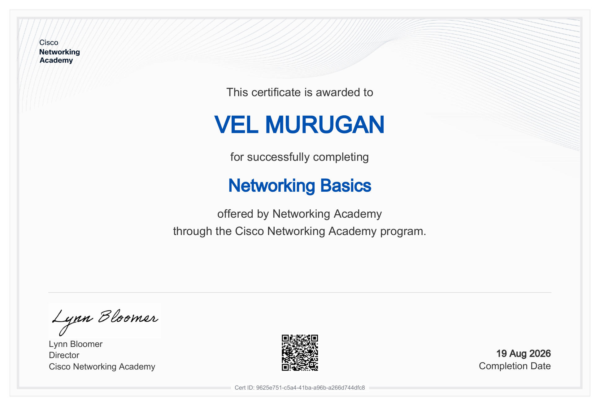
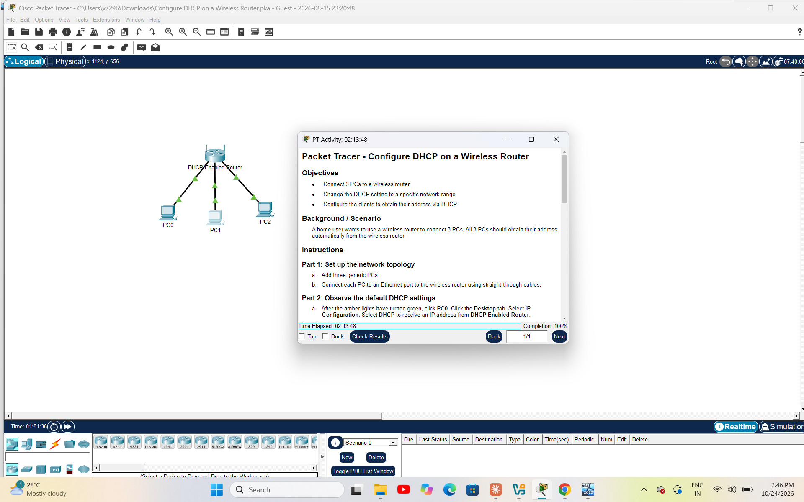
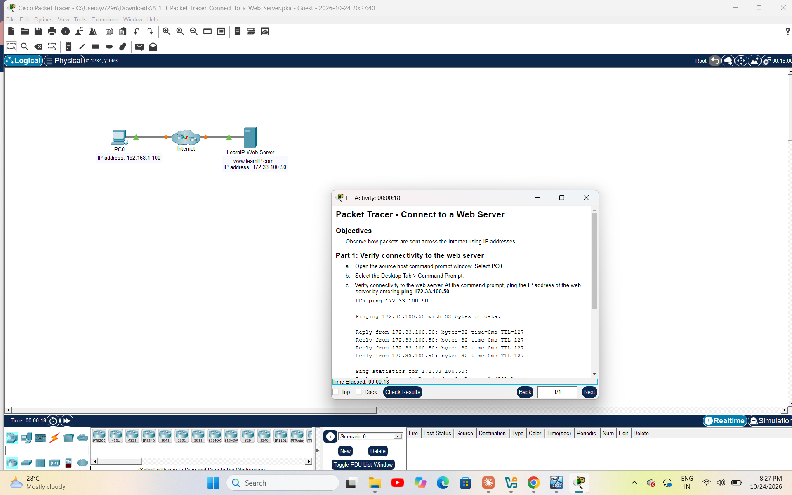
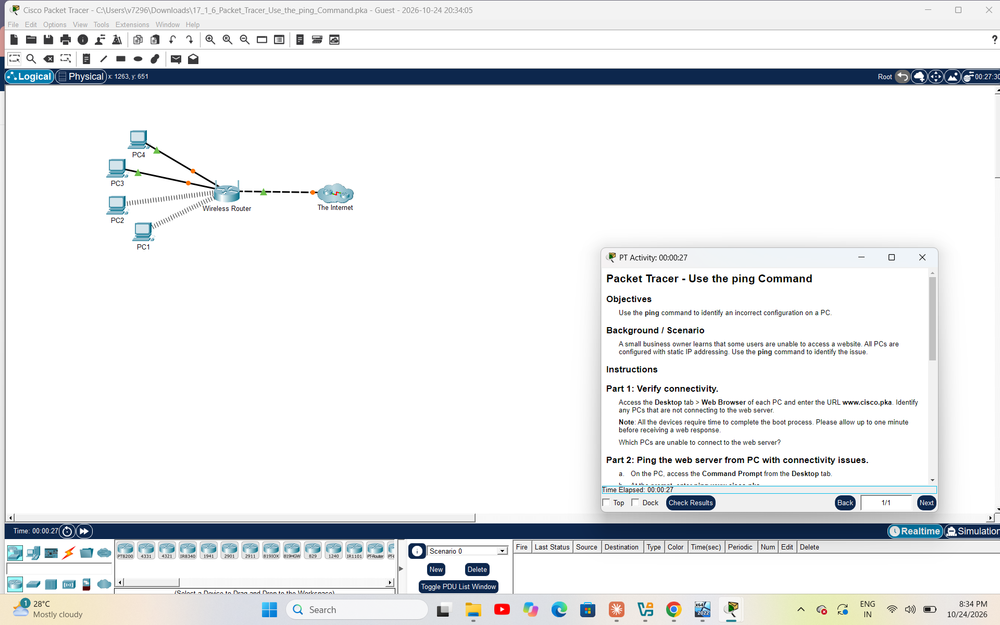
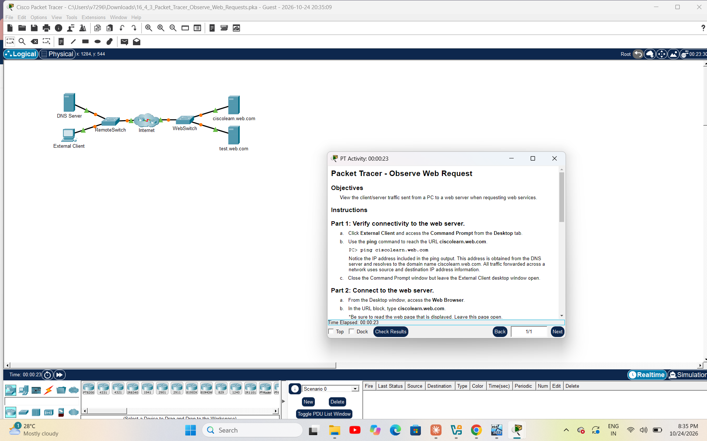

<div align="center">

# 🌐 Networking Basics: Cisco Packet Tracer Projects

**Hands-on lab portfolio built during the Cisco Networking Academy "Networking Basics" course**


</div>

---

## 📑 Table of Contents

1. [Project Overview](#-project-overview)
2. [Certification](#-certification)
3. [Project Summary](#-project-summary)
4. [Lab 1: DHCP on a Wireless Router](#1️⃣-lab-1-configure-dhcp-on-a-wireless-router)
5. [Lab 2: Connect to a Web Server](#2️⃣-lab-2-connect-to-a-web-server)
6. [Lab 3: Use the ping Command](#3️⃣-lab-3-use-the-ping-command)
7. [Lab 4: Observe Web Requests](#4️⃣-lab-4-observe-web-requests)
8. [Key Networking Concepts](#-key-networking-concepts)
9. [Skills Demonstrated](#️-skills-demonstrated)
10. [Troubleshooting Approach](#-troubleshooting-approach)
11. [Repository Structure](#-repository-structure)
12. [How to Run the Labs](#️-how-to-run-the-labs)
13. [Conclusion](#-conclusion)
14. [Author](#-author)

---

## 📌 Project Overview

This repository documents practical networking labs completed in **Cisco Packet Tracer**. Together they follow a real-world path: a device joins a network, receives an address, reaches a server across the Internet, is troubleshooted when something fails, and finally has its web traffic analysed packet by packet.

| Item | Details |
|---|---|
| **Course** | Networking Basics, Cisco Networking Academy |
| **Learner** | Vel Murugan |
| **Completion date** | 19 Aug 2026 |
| **Simulation tool** | Cisco Packet Tracer |
| **Evidence** | Topology screenshots, original `.pka` files, certificate |

### 🎯 Project Objectives

- Build and understand small home and office network topologies
- Configure automatic IP addressing using DHCP
- Verify end-to-end connectivity using `ping`
- Identify and correct configuration errors
- Understand how DNS and HTTP work together when a web page is requested

---

## 🎓 Certification



| Detail | Value |
|---|---|
| **Certificate** | Networking Basics |
| **Issued by** | Cisco Networking Academy |
| **Completion date** | 19 Aug 2026 |
| **Certificate ID** | `9625e751-c5a4-41ba-a96b-a266d744dfc8` |

---

## 📊 Project Summary

| # | Lab | Network Type | Main Protocol / Tool | Outcome |
|---|---|---|---|---|
| 1 | Configure DHCP on a Wireless Router | Home LAN (3 PCs) | DHCP | PCs obtain addresses automatically |
| 2 | Connect to a Web Server | Client to Internet server | IP, ICMP (`ping`) | Connectivity to `172.33.100.50` verified |
| 3 | Use the ping Command | Small business (wired + wireless) | ICMP (`ping`) | Faulty PC configuration identified |
| 4 | Observe Web Requests | Client, DNS and web servers | DNS, HTTP | Web request flow understood |

---

## 1️⃣ Lab 1: Configure DHCP on a Wireless Router



### Scenario
A home user wants to connect 3 PCs to a wireless router. All PCs must obtain their IP addresses automatically from the router.

### Objectives
- Connect 3 PCs to a wireless router
- Change the DHCP setting to a specific network range
- Configure the clients to obtain their address via DHCP

### Topology

| Component | Quantity | Role |
|---|---|---|
| Wireless router (DHCP enabled) | 1 | DHCP server and default gateway |
| Generic PCs (PC0, PC1, PC2) | 3 | DHCP clients |
| Straight-through cables | 3 | PC to router connections |

### Steps Performed
1. Added three generic PCs and connected each to an Ethernet port on the router
2. Waited for link lights to turn from amber to green
3. Observed the default DHCP settings on PC0 (Desktop → IP Configuration → DHCP)
4. Changed the router's DHCP settings to the required network range
5. Set each PC to obtain its address automatically and confirmed the new address

### What I Learned

| Concept | Takeaway |
|---|---|
| DHCP | Automatically assigns IP address, subnet mask, default gateway and DNS |
| DHCP range | The router can hand out addresses only within the range configured |
| Benefits | Reduces manual errors and prevents duplicate IP addresses |

---

## 2️⃣ Lab 2: Connect to a Web Server



### Objective
Observe how packets are sent across the Internet using IP addresses.

### Topology Details

| Device | Hostname / Name | IP Address |
|---|---|---|
| PC0 (client) | PC0 | `192.168.1.100` |
| Web server | www.learnIP.com | `172.33.100.50` |
| Network between them | Internet cloud | n/a |

### Steps Performed
1. Opened the command prompt on PC0 (Desktop → Command Prompt)
2. Tested connectivity to the web server:

```
PC> ping 172.33.100.50
```

3. Confirmed that replies were received from the server
4. Accessed the web server from the client

### What I Learned

| Concept | Takeaway |
|---|---|
| IP addressing | Source and destination IP addresses move packets between networks |
| `ping` | Confirms that two devices can reach each other |
| TTL | The TTL value in each reply shows the packet crossed network devices on its way |

---

## 3️⃣ Lab 3: Use the ping Command



### Scenario
A small business owner learns that some users cannot access a website. All PCs use static IP addressing. The `ping` command is used to identify the problem.

### Objective
Use the `ping` command to identify an incorrect configuration on a PC.

### Topology

| Device | Connection Type |
|---|---|
| PC1, PC2 | Wireless |
| PC3, PC4 | Wired |
| Wireless router | Connects all PCs |
| The Internet | Upstream network / web server |

### Steps Performed
1. Opened `www.cisco.pka` in the web browser of each PC
2. Identified which PCs could not connect
3. Opened the command prompt on a failing PC and used `ping` against the web server
4. Compared its IP settings with a working PC to find the incorrect configuration

### What I Learned

| Concept | Takeaway |
|---|---|
| Fault isolation | Test each PC separately to find which ones fail |
| Static IP risks | A single wrong address, mask, gateway or DNS entry can break access |
| Method | Compare a failing device's settings with a working device |

---

## 4️⃣ Lab 4: Observe Web Requests



### Objective
View the client/server traffic sent from a PC to a web server when requesting web services.

### Topology

| Device | Role |
|---|---|
| External Client | Sends the web request |
| RemoteSwitch | Connects the client and DNS server |
| DNS Server | Resolves domain names to IP addresses |
| Internet | Connects remote and web networks |
| WebSwitch | Connects the web servers |
| ciscolearn.web.com | Web server requested |
| test.web.com | Second web server |

### Steps Performed
1. On the External Client, ran:

```
PC> ping ciscolearn.web.com
```

2. Noted the IP address returned by the DNS server for the domain name
3. Opened the Web Browser and browsed to `ciscolearn.web.com`
4. Used simulation mode to follow the packets between devices

### Web Request Flow

| Step | Protocol | What Happens |
|---|---|---|
| 1 | DNS request | Client asks the DNS server for the IP address of the domain |
| 2 | DNS reply | DNS server returns the IP address |
| 3 | HTTP request | Browser asks the web server for the page |
| 4 | HTTP reply | Web server sends the page back to the client |

### What I Learned

| Concept | Takeaway |
|---|---|
| DNS | Converts human-friendly names into IP addresses |
| Client-server model | The client requests and the server responds |
| Simulation mode | Allows each packet to be followed and inspected |

---

## 📚 Key Networking Concepts

| Term | Meaning |
|---|---|
| **IP address** | Unique address that identifies a device on a network |
| **Subnet mask** | Separates the network part of an address from the host part |
| **Default gateway** | Router address used to reach other networks |
| **DHCP** | Protocol that assigns IP settings automatically |
| **DNS** | Protocol that translates domain names into IP addresses |
| **HTTP** | Protocol used to request and deliver web pages |
| **ICMP / ping** | Used to test reachability between devices |
| **TTL** | Limit on how many hops a packet can travel |

---

## 🛠️ Skills Demonstrated

| Skill Area | Skills | Labs |
|---|---|---|
| Network setup | Building topologies, cabling, wireless connections | 1, 3 |
| IP services | DHCP configuration, IP addressing | 1, 2, 3 |
| Testing | Connectivity checks with `ping` | 2, 3, 4 |
| Troubleshooting | Fault isolation, comparing configurations | 3 |
| Protocol analysis | DNS and HTTP traffic in simulation mode | 4 |

---

## 🔍 Troubleshooting Approach

| Step | Action | Example |
|---|---|---|
| 1 | Identify the symptom | Browser cannot reach the website |
| 2 | Check physical links | Link lights are green |
| 3 | Check IP settings | Address, mask, gateway, DNS |
| 4 | Test with `ping` | `ping` the server's IP, then its name |
| 5 | Compare with a working device | Find the setting that differs |
| 6 | Fix and re-test | Correct the setting, then confirm access |

---

## 📁 Repository Structure

```
networking-basics-packet-tracer/
├── README.md
├── pka-files/          (original Packet Tracer lab files)
└── screenshots/
    ├── 00-certificate.png
    ├── 02-dhcp-topology.png
    ├── 03-web-server-topology.png
    ├── 04-ping-command-topology.png
    └── 05-observe-web-requests-topology.png
```

---

## ▶️ How to Run the Labs

1. Install **Cisco Packet Tracer** (free with a Cisco Networking Academy account)
2. Download any `.pka` file from the [`pka-files`](pka-files) folder
3. Double-click the file to open it in Packet Tracer
4. Read the activity instructions in the pop-up window
5. Click **Check Results** to see the completion percentage

---

## ✅ Conclusion

These labs gave me practical experience with the core building blocks of a network: addressing, DHCP, connectivity testing, troubleshooting and web traffic analysis. They provide a solid foundation for further study such as routing, switching and network security.

### 🚀 Next Steps
- Continue to the next Cisco Networking Academy courses
- Practise VLANs, routing and switching in Packet Tracer
- Study for entry-level networking certifications

---

## 👤 Author

**Vel Murugan**
🔗 LinkedIn: [Velmurugan Anand](https://www.linkedin.com/in/velmurugan-anand)
📧 Email: velmurugananand673@gmail.com

> *If you find this project helpful, please give it a ⭐*
